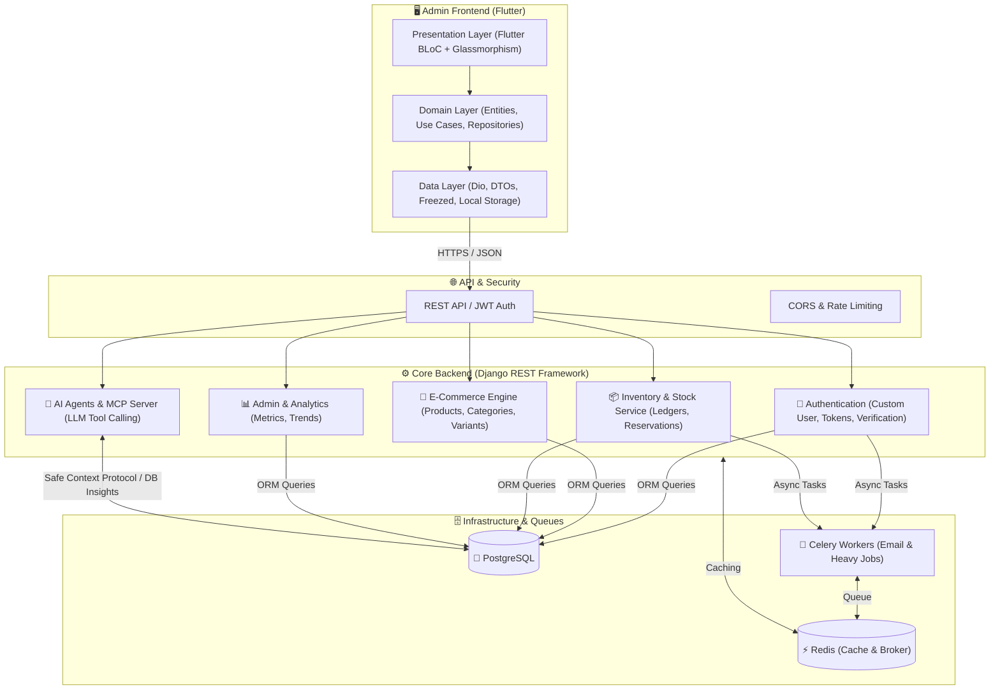

# 🛍️ Stylish — AI-Powered E-Commerce & Admin Platform

<p align="center">
  
  
  
  
  
  
</p>

---

## 📖 Overview

**Stylish** is an enterprise-grade, full-stack e-commerce and administration ecosystem designed and built with clean engineering practices. It bridges a high-performance **Flutter admin dashboard** with a robust, scalable **Django REST Framework (DRF)** backend, paired with an **AI analytics agent layer** utilizing the **Model Context Protocol (MCP)** and LLMs.

Unlike simple demo projects, **Stylish** is engineered around **Domain-Driven Design (DDD)** principles, transactional stock management, service layers, asynchronous task queues, and clean state management.

---

## 🏛️ System Architecture



---

## ✨ Key Highlights & Capabilities

### 🔐 1. Authentication & Security
- **Custom User Architecture:** Extended Django user model supporting phone/email identities and granular roles.
- **JWT Lifecycle:** Dual-token workflow (Access & Refresh tokens) with rotation and secure blacklisting.
- **Account Verification:** Email-based account activation and cryptographically secure password reset flows.
- **Defensive API:** Strict payload sanitization, throttling, and CORS protection.

### 📦 2. E-Commerce & Inventory Core
- **Comprehensive Product Catalog:** Hierarchical categories, dynamic attributes, color/size variations, SKU generation, and image gallery management.
- **Atomic Stock Ledger:** Dedicated inventory service with strict stock reservations, release timeouts, low-stock triggers, and ledger transactions preventing overselling.
- **Tiered Pricing & Promotions:** Flexible base pricing, sale discounts, and campaign rules.

### 🤖 3. AI-Assisted Business Intelligence (LLM & MCP)
- **Model Context Protocol (MCP):** Structured, secure protocol layer enabling LLMs to safely query database metrics without arbitrary code execution.
- **Natural Language Business Inquiries:**
  - *"Which product variants experienced the highest stock velocity this week?"*
  - *"Summarize revenue trends and predict inventory restock dates."*
- **Smart Recommendations:** Automated product correlation and inventory replenishment alerts.

### 📱 4. Flutter Admin Dashboard
- **Clean Architecture:** Strict decoupling into `Presentation`, `Domain`, and `Data` layers.
- **BLoC State Management:** Deterministic UI state flow using `flutter_bloc` and `Equatable`.
- **Modern UI/UX:** Responsive dashboard layout featuring glassmorphism accents, smooth state transitions, and responsive tables.
- **Network Resilience:** Centralized `Dio` client with auto-refresh interceptors and structured error handling (`Dartz` Either type).

---

## 📂 Repository Structure

```
.
├── stylish_admin_frontend/          # 📱 Flutter Admin Dashboard
│   └── stylish_admin/
│       ├── lib/
│       │   ├── app/                 # App config & theme
│       │   ├── core/                # Network (Dio), errors, DI, utils
│       │   ├── features/            # Feature modules (auth, dashboard, etc.)
│       │   └── main.dart            # Entry point
│       └── pubspec.yaml             # Flutter dependencies
│
├── stylish_backend/                 # ⚙️ Django REST API Backend
│   ├── requirements.txt             # Python packages
│   └── stylish/
│       ├── manage.py
│       ├── authentication/          # JWT, Custom User, Verification
│       ├── ecommerce/               # Products, Categories, Variations
│       ├── inventory/               # Stock ledger, Reservations, Services
│       ├── ai_agents/               # LLM integrations & MCP controllers
│       ├── analytics/               # Aggregation & metrics computation
│       ├── admin_dashboard/         # Admin API endpoints
│       └── stylish/                 # Global settings, Celery, WSGI/ASGI
│
└── README.md
```

---

## 🛠️ Tech Stack & Ecosystem

| Layer | Technologies |
|---|---|
| **Frontend** | Flutter 3.x, Dart, BLoC, Freezed, Dartz, Dio, GetIt |
| **Backend** | Python 3.12+, Django 5.2, Django REST Framework |
| **Database** | PostgreSQL 16+ via `psycopg 3` |
| **Cache & Queue** | Redis, Celery (Distributed task execution) |
| **Security & Auth** | SimpleJWT, PyJWT, Python-Decouple, CORS Headers |
| **AI / Tool Calling**| LLMs, Model Context Protocol (MCP), Structured JSON APIs |

---

## 🚀 Getting Started

### 📋 Prerequisites
Make sure you have the following installed on your machine:
- [Flutter SDK](https://docs.flutter.dev/get-started/install) (`>= 3.0.0`)
- [Python 3.12+](https://www.python.org/downloads/)
- [PostgreSQL](https://www.postgresql.org/)
- [Redis Server](https://redis.io/)

---

### 1️⃣ Backend Setup (Django)

1. **Navigate to the backend directory:**
   ```bash
   cd stylish_backend
   ```

2. **Create and activate a virtual environment:**
   ```bash
   python3 -m venv .venv
   source .venv/bin/activate  # On Windows: .venv\Scripts\activate
   ```

3. **Install dependencies:**
   ```bash
   pip install -r requirements.txt
   ```

4. **Configure Environment Variables:**
   Create a `.env` file in `stylish_backend/stylish/`:
   ```env
   SECRET_KEY=your-super-secret-django-key
   DEBUG=True
   ALLOWED_HOSTS=localhost,127.0.0.1

   # PostgreSQL Database Configuration
   DB_NAME=stylish_db
   DB_USER=stylish_user
   DB_PASSWORD=your_secure_password
   DB_HOST=localhost
   DB_PORT=5432

   # Redis & Celery
   REDIS_URL=redis://localhost:6379/1
   CELERY_BROKER_URL=redis://localhost:6379/0

   # Email Configuration (Optional / Development)
   EMAIL_HOST=smtp.gmail.com
   EMAIL_PORT=587
   EMAIL_HOST_USER=your_email@gmail.com
   EMAIL_HOST_PASSWORD=your_app_password
   ```

5. **Run Migrations & Start Server:**
   ```bash
   cd stylish
   python manage.py makemigrations
   python manage.py migrate
   python manage.py createsuperuser
   python manage.py runserver
   ```

6. **Start Celery Worker (in a separate terminal):**
   ```bash
   cd stylish_backend/stylish
   celery -A stylish worker --loglevel=info
   ```

---

### 2️⃣ Frontend Setup (Flutter)

1. **Navigate to the Flutter app:**
   ```bash
   cd stylish_admin_frontend/stylish_admin
   ```

2. **Install Flutter packages:**
   ```bash
   flutter pub get
   ```

3. **Generate code (Freezed / JSON Serializer):**
   ```bash
   flutter pub run build_runner build --delete-conflicting-outputs
   ```

4. **Launch the application:**
   ```bash
   # Run in Chrome (Web)
   flutter run -d chrome

   # Or run on connected device / emulator
   flutter run
   ```

---

## 🧪 Testing & Code Quality

```bash
# Run Django backend tests
cd stylish_backend/stylish
python manage.py test

# Run Flutter frontend tests & analyze
cd stylish_admin_frontend/stylish_admin
flutter analyze
flutter test
```

---

## 🗺️ Roadmap & Upcoming Milestones

- [x] Custom Authentication & JWT Token Workflow
- [x] Clean Architecture Setup in Flutter
- [x] Product & Inventory Ledger Services
- [ ] Multi-tenant Store & Vendor Support
- [ ] Real-time Notifications via WebSockets (Django Channels)
- [ ] Containerization with Docker Compose & CI/CD GitHub Actions
- [ ] Advanced visual dashboard charts & exportable reports

---

## 🤝 Contributing

Contributions, feature suggestions, and bug reports are welcome!
1. Fork the Project
2. Create your Feature Branch (`git checkout -b feature/AmazingFeature`)
3. Commit your Changes (`git commit -m 'Add some AmazingFeature'`)
4. Push to the Branch (`git push origin feature/AmazingFeature`)
5. Open a Pull Request

---

## 📄 License

Distributed under the MIT License. See `LICENSE` for more information.

<p align="center">Built with ❤️ for modern e-commerce engineering.</p>
